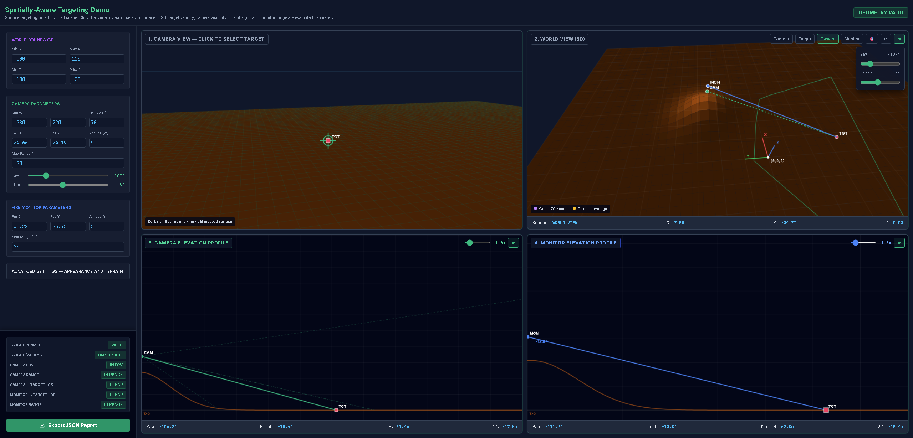

# Spatial Target Planning

A browser-based demo for exploring the geometric relationship between a camera, a terrain-surface target, and a fire monitor.

**Live demo:** [Spatial Target Planning](https://wobuzaijiaa.github.io/hotspot2actuator/)

## Overview

The demo models a camera and fire monitor in a shared world coordinate system. Users can select a target on the terrain, evaluate camera visibility and terrain clearance, and calculate the monitor's geometric aiming angles.

It is intended for geometry exploration and validation, not operational fire detection or suppression.

## Core Features

- **World and terrain:** Configurable scene bounds, built-in flat and synthetic terrain, heightmap input, and optional terrain plugins.
- **Camera:** Configurable position, orientation, image resolution, field of view, and maximum range.
- **Target selection:** Select a terrain-surface target in the camera view or directly in the 3D world view. Camera selection infers the target position from a viewing ray intersecting the modeled terrain.
- **Monitor aiming:** Calculate pan, tilt, horizontal distance, 3D distance, and relative target height.
- **Visualization:** Camera view, world view, camera elevation profile, and monitor elevation profile.
- **Validation:** Check target domain and surface validity, camera field of view and range, camera and monitor line of sight, and monitor range.
- **JSON export:** Save the current configuration, target position, geometric results, validation status, and modeling assumptions.

## Typical Workflow

1. Configure the world bounds and terrain.
2. Set the camera position, orientation, image parameters, and range.
3. Set the fire monitor position and range.
4. Select a target in the camera or world view.
5. Review target validity, visibility, range, terrain clearance, and monitor aiming geometry.
6. Export the results as JSON if needed.

Results are recalculated when relevant camera parameters or terrain settings change. Camera-selected targets are re-localized against the active terrain.

## Coordinate System

The demo uses a shared Cartesian world coordinate system:

- **X, Y:** Horizontal position.
- **Z:** Elevation.
- **Units:** Meters for positions, bounds, and distances; degrees for camera yaw/pitch and monitor pan/tilt.
- **Terrain:** A heightfield represented by elevation as a function of horizontal position, $Z = H(X,Y)$.
- **Monitor angles:** Pan is referenced to the positive world X direction; tilt is measured relative to the horizontal plane.

Camera and monitor positions are defined in world coordinates. The current model supports surface targets only; target-height offsets above the terrain are not implemented.

## Validation and Limitations

The status panel reports individual checks because successful target localization does not guarantee visibility or reachability. A target may be localized but outside the camera field of view, beyond a range limit, or blocked by terrain.

Important limitations:

- Camera-based localization uses a viewing-ray intersection with modeled terrain; it does not measure depth from a real camera image.
- Line-of-sight checks sample terrain clearance only. Buildings, vegetation, equipment, and other arbitrary 3D obstacles are not modeled, and narrow obstructions may be missed.
- Monitor pan and tilt are geometric results, not physical actuation commands. Hardware constraints and real-world performance are not fully modeled.
- Heightmaps represent surface elevation, not photographic texture or semantic scene content. Valid target locations depend on terrain coverage and world bounds.
- The simplified scene is not a full 3D facility model or a substitute for site validation.

Use the demo to explore geometric relationships, not to make operational or safety-critical decisions.

## Running the Demo

Open `index.html` in a modern browser. No build step is required. Some styling and fonts are loaded from external CDNs and may require an internet connection.

For detailed geometric definitions and equations, consult the accompanying geometry-model reference.
